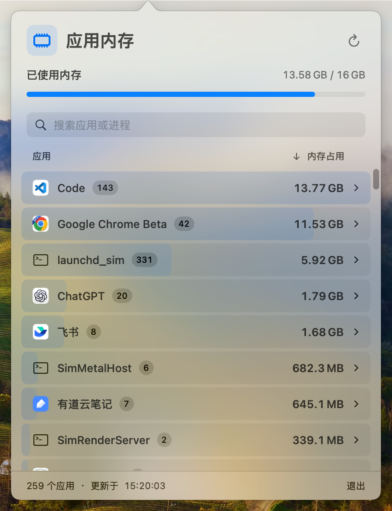
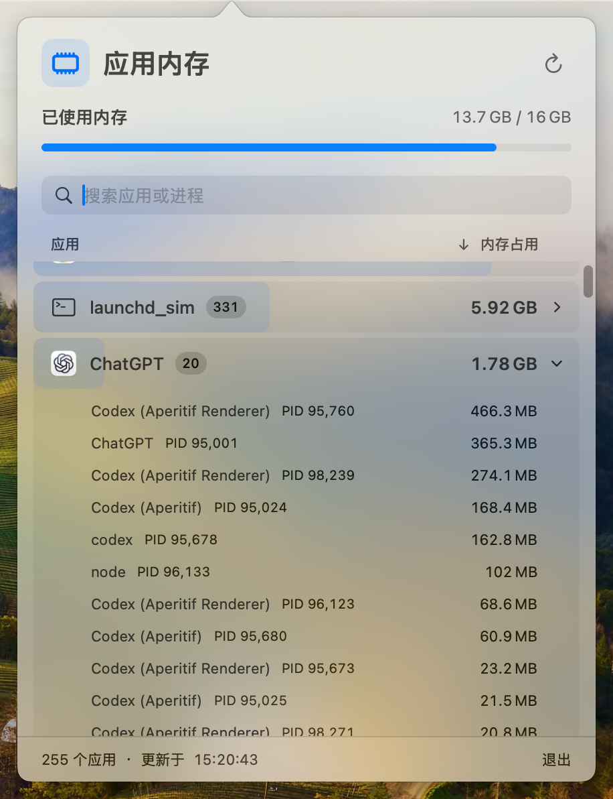

# RAMScope

原生 macOS 菜单栏内存监控工具（App 名「内存用量」），不占 Dock，无第三方依赖。

点菜单栏的内存条图标弹出面板：顶部是整机「已使用内存」，下面按内存占用对应用排序。点开应用可以看进程明细，也可搜索应用名、进程名或 PID。面板打开时每两秒刷新，点面板外部收起后停止采样，后台不耗 CPU。

<p>
  
  
</p>

## 下载安装

需要 macOS 14 或更新版本，Apple 芯片和 Intel 均可。

1. 到 [Releases](https://github.com/colinli007/RAMScope/releases/latest) 下载 `RAMScope-x.y.z.dmg`。
2. 打开 DMG，把「内存用量」拖进「应用程序」。
3. 首次打开：本应用没有经过 Apple 公证，第一次双击会提示「无法验证开发者」。点「完成」后，到 **系统设置 → 隐私与安全性**，在页面下方点「仍要打开」并确认。之后就能正常打开。

   也可以在终端里执行下面这行，然后直接双击打开：

   ```bash
   xattr -dr com.apple.quarantine "/Applications/内存用量.app"
   ```

打开后只出现在菜单栏，不占 Dock；退出点面板右下角的「退出」。

## 从源码构建

需要支持 Swift 6 的 Xcode。

```bash
xcodebuild -project RAMScope.xcodeproj -scheme RAMScope -configuration Release -derivedDataPath build build
cp -R "build/Build/Products/Release/内存用量.app" /Applications/
```

开发时：

1. 打开 `RAMScope.xcodeproj`。
2. 选择 `RAMScope` scheme 和 `My Mac`，按 `⌘R` 构建并运行。

工程使用本地签名，无需配置开发者团队。源码位于 `RAMScope/`：

| 文件 | 作用 |
| --- | --- |
| `RAMScope.swift` | 菜单栏图标与弹出面板，面板显示 / 收起时启停采样 |
| `MemorySampler.swift` | 读取进程内存、沿父进程链按应用归并、系统已用内存 |
| `MemoryView.swift` | SwiftUI 界面 |

`内存用量.app/Contents/MacOS/RAMScope --snapshot` 会采样一次并把结果以 JSON 输出到标准输出，便于脚本调用和排查。

## 统计口径

- **单个应用的内存**：归属进程的内存足迹（`ri_phys_footprint`）之和，与「活动监视器」的「内存」列同一个值。它包含被压缩的内存，所以各应用加起来可以超过物理内存。
- **归属**：内存算在启动它的一方。应用包内的 Helper 计入外层应用；应用启动的子进程沿父进程链计入该应用（如编辑器终端里的 `node` 计入编辑器）；父进程链上找不到应用的进程，归到所在进程树的根进程名下（如模拟器进程归到 `launchd_sim`）。
- **已使用内存**：应用内存 + 联动内存 + 被压缩内存，对应活动监视器底部的「已使用内存」。
- 只统计当前用户的进程；root 等其他用户的进程（如 WindowServer）读不到，不在列表里。

## 许可证

[MIT](LICENSE)
